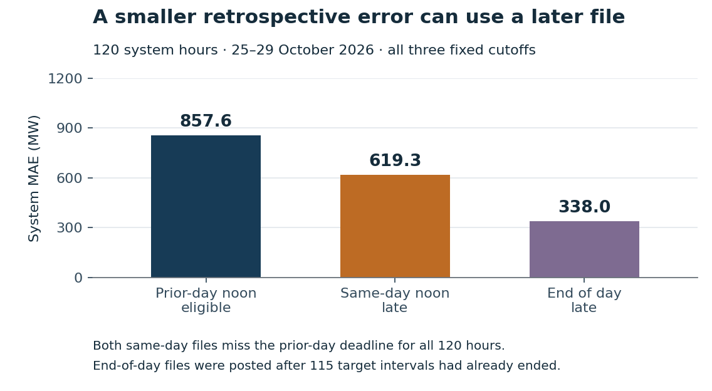

# Check the forecast deadline before scoring a scheduling decision

A day-ahead load review needs the forecast file eligible at its decision deadline. Substituting a later file can make the reported error smaller while answering a different question.

Across **120 system hours on 25–29 October 2026**, system MAE is **857.6 MW** at the prior-day noon cutoff, **619.3 MW** at same-day noon and **338.0 MW** using end-of-day files. Both same-day selectors miss the prior-day deadline for every hour. End-of-day documents were published after **115 intervals had ended**. These lower retrospective errors do not establish an improved scheduling or reserve policy.

The practical safeguard is straightforward: retain the document ID and publication time, select against an explicit deadline, and return unavailable when inputs are late, stale or ambiguous. [The local exercise](results/exercise.json) demonstrates one real selection and two authored unavailable-input cases.

~~~powershell
python src/deadline.py --deadline "2026-10-24T12:00:00-05:00"
~~~

The command selects document 1290329758, declared published at 11:30 Central with age 1800 seconds. It exits 0 on selection and 2 on unavailable inputs. The 90-minute age limit and noon cutoff are authored study settings; neither is an empirically optimized limit or a claim about ERCOT's actual scheduling deadline.

## Read the evidence

[Five-page independent manuscript](paper/manuscript.pdf) · [LaTeX source](paper/main.tex) · [Fixed protocol](PROTOCOL.md) · [Source and rights](DATA_RIGHTS.md) · [Original EIA scope limitation](SOURCE_HISTORY.md)

All 5 days, 9 source series and 3 cutoffs remain in [3,240 hourly comparisons](results/comparisons.csv), [27 pooled metric cases](results/overall_metrics.csv), [135 daily cases](results/daily_metrics.csv) and [135 peak cases](results/peaks.csv). Exports include MAE, MSE, RMSE, signed bias, WAPE, maximum absolute error, maximum underprediction and timing flags. The system total is a separately reported series, never added to its zones.

The same-day noon file worsens system MAE on 25 October: 668.6 versus 591.3 MW at the eligible cutoff. North's prior-day WAPE is 7.6%, compared with 1.6% for the system. [Daily results](figures/daily_system_errors.png) and [all series](figures/all_series_wape.png) expose those differences. Full-resolution PDF/SVG/PNG figures are in [figures/](figures).

## Reproduce the saved-data study

Use CPython 3.10 or later. Install the analysis/presentation requirements and the PDF checker, then run into a new external directory.

~~~powershell
python -m pip install -r requirements.txt -r requirements-review.txt
python src/replay.py --out C:\Temp\forecast-audit-replay
~~~

On Linux, use an absolute external output directory such as /tmp/forecast-audit-replay. The directory must not already exist; earlier evidence is preserved. Add --analysis-only to run native/numerical/fixture checks without the figure/PDF checkers.

The source projection and separate native check reconcile 32 documents, 2,242 native CSV rows and 4,320 projected cells through 101,139 finite conditions. Retained ZIP bytes were independently checked before publication. Independent SQLite joins and exact rational arithmetic verify 48,524 numerical, identity and timing conditions. Twenty-two authored fixture methods and three exercise cases pass. Fifty-three source/method dependencies were committed before the first score command.

Two full-history Git clones in CPython 3.10.11 and 3.12.14 each reproduced six result files byte for byte and left 40 source files unchanged. [Runtime receipts](results/) distinguish analysis replay from source reacquisition and historical delivery. Three figures bind 45 values, 360 actual SVG coordinates, 45 numeric labels and nine asset hashes. The paper binds 43 used numbers to sources; all five rendered pages were inspected.

## What this supports

This is a short descriptive archive audit and a local implementation exercise. Metadata and four non-cohort schema files were inspected before the fixed source plan; all target-day values were captured afterward. There is no fitted model, tuning search, sampling interval or blinded forecast claim. Related hours, days and zones are dependent.

The captured source's declared publication time does not independently prove immutable original content, first-byte availability or historical delivery to an analyst. Actual loads are retrospective source labels, not proven revision-free or settlement-final. Same-day files may include later information or revised past values. Repeated-hour DST handling is deliberately unsupported and rejected.

The original EIA/NOAA proposal for learned residual corrections, calibrated intervals, held seasons and authority transfer remains unexecuted. No improved reserve requirement, saving, deployment, adoption, causal effect or new estimator follows from this five-day study. Prospective operational work would need ingest monitoring, immutable content retention, verified real deadlines and sustained evaluation.

ERCOT's raw public factual data are attributed under [its terms](https://www.ercot.com/help/terms). Code uses MIT. No ERCOT logo or endorsement is implied. This reviewed independent manuscript is public; separate formal-publication projects, including Azure optimization, remain private.
